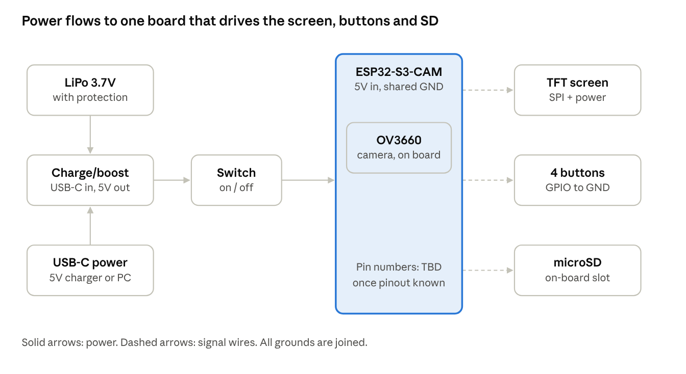

# DIY retro camera project: research and development brief

Oct 3, 2026 · @JT

## Summary

This project is a gift of two small retro digital cameras for friends, either bought for under US$80 each or built from an ESP32-S3 camera board and a 3D-printed case.

- Buy shortlist: Yashica Funtastic Peanuts (about $27–30), Yashica Mini (about $45–55), Escura InstantSnap.novo (about $57–61), or a used 2000s CCD compact (under $50).
- Build option: ESP32-S3-CAM with OV3660, a small colour TFT, four buttons, a LiPo with USB-C charging, and a printed shell. Extra parts cost roughly ¥50–100 (about US$7–14) per camera, by estimate.
- Recommendation: buy a safe option first and build in parallel. If the build is not ready by the gift date, the bought camera covers it.
- Design lean: a flat, wide Escura-style body hides a thicker electronics stack better than a 22 g keychain shell.
- Next step: confirm the exact ESP32-S3 board model, the screen choice, and the deadline.

Update, 3 Oct: decided to build both cameras, with finish and feel first and Chuzhao-level photos accepted. The cost target is below buying a Yashica Mini or InstantSnap. The full plan is in 4-week build plan.

## Context and constraints

The builder wants a cheap, compact camera with a vintage feel and a built-in preview screen for two friends, and already owns the tools to make one.

- Owned camera: a Chuzhao vintage digital camera. They like the vibe and the rotary dial, but find the twin-lens shape and the top-mounted screen awkward.
- Gift brief: digital camera, vintage vibe if possible, compact, strict maximum US$80, with a screen to preview shots.
- Reference designs: the Yashica Funtastic keychain camera and the Escura InstantSnap.novo.
- Parts on hand: a 3D printer; an ESP32-S3 camera board with an OV3660 (exact model not yet stated); a 0.96 inch SSD1306 OLED (monochrome, 128×64); large buttons only. No batteries yet.
- Alternative board considered: XIAO nRF52840 Plus, for its small size.
- Buying route: Taobao.
- Related project: a battery-powered table tennis IMU board, which might share the same battery order.

## Commercial cameras researched

The Yashica Mini and Funtastic are the strongest bought options; the LUODIN and generic "CCD" listings have too little verified information to trust.

| Camera | Price (US$, approx.) | Screen | Size and weight | Image and storage | Reviews and caveats |
| --- | --- | --- | --- | --- | --- |
| [Chuzhao](https://amateurphotographer.com/review/chuzhao-retro-camera-review/) (owned) | 40–55 | Small square screen on top | 9×5×4 cm | 12MP 1/4 in sensor, square images, autofocus, 16GB card included | Flare and blown highlights in one review; quality varies by seller; Trustpilot 3.9 of 5 across 38 reviews |
| [Yashica Mini](https://www.yashica.com/product-page/yashica-mini-digital-camera-hello-kitty-ver) (Hello Kitty, Peanuts) | 45–55 (€41–49, £49.99, HK$398) | 2 in (Hello Kitty) or 2.4 in (Peanuts), rear | 73.6×35.5×70 mm, 96–113 g | 3–8MP stills, 1080p video, 4x digital zoom, microSD to 32GB, built-in games | No independent hands-on found; sources disagree on fixed focus versus autofocus; licensed brand, with Transcontinenta Group listed as manufacturer |
| [Yashica Funtastic](https://www.adorama.com/yashica-funtastic-keychain-digital-camera-1-mp/p/ysfntstic) | 27–30 | 0.96 in, flips 180° | 63×22×25 mm, 22 g | 1MP, 1440×1080, 30 fps AVI, 180 mAh, USB-C, microSD to 64GB | Feels well made; shaky handheld, limited filters; underwhelming next to the Charmera but above generic clones |
| [LUODIN dual LCD](https://www.fortress.com.hk/en/product/dual-lcd-digital-camera/p/14063580) | \~46 (HK$358) | Two LCDs, sizes unknown | \~100 g | Unknown | No specs or independent reviews found; the suggested film filters are unverified |
| Generic "retro CCD" | 16–42 | Usually 2.4 in rear | Varies | Inflated claims: interpolated megapixels, "CCD" labels on CMOS sensors | Marketplace sellers with few reviews; avoid |
| [Kodak Charmera](https://www.tomsguide.com/cameras-photography/kodak-charmera-review) | 29–35 | Very small | 58×24.5×20 mm, 30 g | 1.6MP, 1440×1080, 200 mAh | Amateur Photographer: awful quality and screen; TechRadar and Tom's Guide: poor but charming; sold as a blind box |
| [Escura InstantSnap.novo](https://petapixel.com/2026/09/14/instantsnaps-60-instant-print-inspired-toy-camera-gets-a-dramatic-redesign/) | 57–61 (¥8,894; Pinkoi US$61.08) | 1.3 in rear, plus open optical viewfinder | 106×16×60 mm, 38 g | Sensor not confirmed (original: 1.3MP, 1200×1440); microSD 4–64GB | Swappable viewfinder frames, Y2K and film filters; no English hands-on review found |
| [Used 2000s CCD compact](https://www.gearpatrol.com/tech/vintage-digital-camera) | Under 50 | Rear LCD | Pocket compacts | Real CCD sensors, optical zoom | Most authentic look; check battery, charger, card type and condition |
| [DIGI+ Dual Display](https://petapixel.com/2026/07/03/new-selfie-friendly-dual-display-camera-has-big-y2k-energy/) (Japan) | \~50 (¥7,980) | Rear plus fixed front screen | Not stated | 5MP | PetaPixel expects weak image quality |

None of these has a rotary dial. Over budget: [Kodak PIXPRO](https://www.photoworkout.com/best-compact-cameras/) FZ45 and C1 at about $100, FZ55 at about $130. The Holga Digital was excluded: no screen, about $86 at launch. Prices come from retailer and press listings seen in search results; full pages were not opened, so confirm before ordering.

## Buy versus build

Buying is the safe choice for the gift; building is cheap but costs time and risks missing the date.

|  | Buy (Yashica Funtastic or Mini) | Build (ESP32-S3-CAM) |
| --- | --- | --- |
| Cost per camera | $27–30 (Funtastic); $45–55 (Mini) | Extra parts about ¥50–100 (US$7–14), plus filament |
| Cost for two | About $55–110 | About ¥100–200 (US$14–28), plus an optional spare board (¥50–100) |
| Builder time | Minutes | Estimate: several weekends, 15–30+ hours for a first unit with gallery and video |
| Risk of missing the date | None | Real: camera, power and case are all first builds |
| Image quality | Funtastic 1MP; Mini up to 8MP interpolated | OV3660 3MP, likely better than the Funtastic |
| Size | Funtastic 22 g keychain; Mini about 100 g | Likely thicker than both once the battery is in |
| Gift feel | Polished and branded | Personal and unique; plainer unless the case turns out well |

Recommended: order the safe camera now and build in parallel. Give the DIY unit as an extra, or swap it in if it works. Costs are estimates at ¥7 per US$1, not quotes.

## DIY requirements

The build counts as finished when it takes photos, saves them to an SD card, previews live, plays back a gallery, and runs on a rechargeable battery.

- Must have: photos stored on a microSD card.
- Must have: live preview on a screen before shooting.
- Must have: view saved photos and step through the gallery.
- Must have: battery powered, charged over USB-C, with power on and off.
- Ideal: video recording.
- Not required: a flip screen.
- Hardware need: small tactile buttons, since only large ones are on hand.

Two body styles are open:

- Funtastic-style keychain: 63×22×25 mm and 22 g is hard to match with a dev board and battery, so expect a thicker first version.
- Escura-style flat body with a see-through viewfinder: the Novo is 106×16×60 mm. A wide, flat shell with a framing hole hides a thicker stack more gracefully. This is a design judgement; no one was found building it.

Use an original design and branding. Do not copy Yashica, Peanuts, Hello Kitty or Escura marks.

## Hardware decisions and technical findings

Stay on the ESP32-S3: it has a native camera interface, SD support and enough memory for preview, capture and playback.

| Topic | Decision | Reason and findings |
| --- | --- | --- |
| Board family | ESP32-S3, not XIAO nRF52840 Plus | Seeed's XIAO comparison shows an onboard camera only on the ESP32S3 Sense. The nRF52840 would need an SPI camera module. This is my understanding and was not verified. |
| Board model | Confirm the exact ESP32-S3-CAM model | Generic boards often lack LiPo charging and pin counts vary. Option: XIAO ESP32S3 Sense (about $14; 21×17.5 mm, 8MB PSRAM, microSD to 32GB, LiPo charging at about 100 mA, 11 GPIO), which most compact ESP32-S3 camera builds use. Check the OV3660 module fits its connector. |
| Camera | OV3660, 3MP | Max 2048×1536. One module listing gives 15 fps at 2048×1536 and 20 fps at 1080p. One developer needed extra DMA and PSRAM settings on a XIAO. The esp32-camera driver supports it; non-JPEG output above QVGA needs PSRAM. |
| Screen | Small colour TFT: 0.96 in 160×80 ST7735, or 1.14–1.3 in ST7789 | A 128×64 monochrome OLED can show a dithered preview, but one maker called it the lower limit for a useful viewfinder. Gallery browsing would suffer. Keep the OLED for bring-up. |
| Battery | Single-cell 3.7V LiPo with protection board, about 500 mAh | Capacity is flexible (500–1000 mAh by case space). One build measured about 155 mA average and 366 mA peak on battery, so roughly 3 hours continuous at 500 mAh (my arithmetic). Check connector and polarity. |
| Charge and boost | USB-C charge and boost module (IP5306-type), 5V out | Most generic ESP32-S3-CAM boards run from 5V and lack a charger. Check the module's output current rating. |
| Power switch | Slide switch on the module's 5V output | Charging still works when the camera is off. A hard switch is preferred: deep sleep on the Sense with its expansion board is quoted at about 3 mA, versus 14 µA on the base board. |
| Buttons | Four tactile switches | Shutter, mode, previous, next, wired to GND with internal pull-ups. The GPIO budget is tight; a resistor ladder is a fallback. |
| Video | Stretch goal: MJPEG frames into an AVI file on SD | The MJPEG2SD project does this on ESP32-S3. Rate depends on SD speed, frame size and quality. Expect VGA-class video. |
| Software | Arduino or ESP-IDF with the esp32-camera driver | JPEG display on the TFT via TFT\_eSPI and TJpg\_Decoder is a common route; LVGL is optional. |

## Wiring and connections

The battery feeds the charge/boost module, which gives 5V through a switch to the board; the board's signal wires reach the screen, four buttons and the SD slot.

| Link | Wires | Connector |
| --- | --- | --- |
| Battery to charge/boost module | 2 (red +, black −) | JST plug, so the cell can be unplugged |
| USB-C to module | None extra | The module has its own USB-C port |
| Module 5V out, via switch, to board 5V pin | 2 (red) | Solder |
| Module GND to board GND | 1 (black) | Solder, joined to all other grounds |
| TFT to board | About 7: 3V3, GND, SCK, MOSI, CS, DC, RST, plus backlight | Dupont while prototyping, then solder |
| Four buttons | 4 signal wires plus one shared ground | Solder; other contact to GND, using internal pull-ups |
| microSD | None | Slot on the board (check yours) |
| Camera | None | OV3660 plugs into the board |

Pin numbers are not assigned yet because they depend on the board's pinout. Never connect the raw cell to the board's 3V3 or 5V pin: the module boosts the cell to 5V. Check battery polarity with a multimeter first.

## Taobao shopping list

The extra parts for two cameras come to roughly ¥100–200 (US$14–28) at ¥7 per US$1; these are estimates, not quotes.

| Item | Taobao search terms | Qty (two cameras) | Est. price (¥) |
| --- | --- | --- | --- |
| 0.96 in colour TFT | `0.96寸 IPS 彩屏 ST7735 SPI 160x80` | 2 | 8–15 each |
| LiPo 3.7V, 500 mAh, protected | `3.7V 聚合物锂电池 带保护板 503040` | 2 (optional: 1–2 smaller 200–300 mAh cells for the IMU project) | 8–15 each |
| USB-C charge and boost module | `Type-C 充电升压一体模块 5V 锂电池` | 2 | 3–8 each |
| Tactile buttons | `轻触开关 6x6` (or `3x4`) | 20 | 2–5 per pack |
| Slide switches | `微型拨动开关 MSK12C02` | 5 | 3–6 per pack |
| microSD 32GB Class 10 | `32GB microSD Class10` | 2 | 20–35 each |
| JST PH2.0 2-pin pigtails, male and female | `JST PH2.0 2P 公母对插线` | 5 pairs | 6–14 for wires and connectors together |
| 30AWG silicone wire, several colours | `30AWG 硅胶线 多色` | 1 set | (included above) |
| Dupont jumpers, mixed | `杜邦线 公母 母母 混合` | 1 set | (included above) |
| Heat-shrink assortment | `热缩管 套装 2mm 3mm` | 1 pack | (included above) |
| Header pins | `排针 2.54 单排` | 1 pack | (included above) |
| Spare ESP32-S3-CAM (optional) | Same listing as the current board | 1 | 50–100 |

Tools, if not already owned: multimeter (`万用表`), soldering iron with solder and flux (`电烙铁 焊锡丝 助焊剂`), Kapton tape (`高温胶带 聚酰亚胺`), hot glue gun (`热熔胶枪`), breadboard (`面包板`), M2 self-tapping screws (`M2 自攻螺丝`), heat-set inserts (`热熔铜螺母`).

Before ordering:

- Ask the battery seller for bare wires or a JST-PH2.0 plug, and check polarity with a multimeter before connecting anything.
- Confirm the charge module's USB-C input and 5V output current rating.
- Check lithium battery shipping rules with the seller or forwarder.

## Build plan

Build in seven steps, proving each on the bench before the next, with the printed case near the end.

1. Decide: confirm the board model and pinout, pick the screen, order parts, and sketch the GPIO budget. Camera, SD and USB take many pins.
2. Bench prototype with no case: camera init and live preview on the screen. The shutter button captures a full-resolution JPEG to SD, then returns to preview.
3. Gallery: read JPEGs from SD, decode and scale them to the screen, and step through with previous and next.
4. Video (stretch): record MJPEG frames to an AVI on SD. Optional lo-fi look: grain, tint, date stamp.
5. Power: add the battery, slide switch and USB-C charging. Test charge and discharge before the case.
6. Case: cardboard mock-up first, then a test-fit print with cut-outs for lens, screen, four buttons, switch, USB-C and SD. Start thicker than the Funtastic and iterate.
7. Gift readiness: test battery life, SD reliability and a few days of real use. Keep the bought camera as backup.

## Prior art and resources

No one was found building a Funtastic or Escura clone, but several ESP32-S3 camera builds cover the pieces.

| Project | What it is | Useful for | Notes |
| --- | --- | --- | --- |
| [Keymera](https://www.seeedstudio.com/blog/2026/06/01/keymera-diy-3d-printed-keychain-camera-xiao-esp32s3-sense/) | Printed keychain camera on a XIAO ESP32S3 Sense with OV3660, LiPo, one button, Wi-Fi gallery | Closest to the Funtastic: shell and battery layout | Files sold as licensed digital products (about $10 early-bird); no screen. Check the licence. |
| [Charm-Cam](https://www.makerworld.com/en/models/2838736) | Thumbnail-sized camera on an AI-Thinker ESP32-CAM with a Wi-Fi web interface | Compact packing, SD workflow | Firmware and guide on GitHub (FRSname/charm-cam); no screen. |
| [Obscura One](https://www.printables.com/model/1662215-obscura-one) | Open-source printable ESP32-CAM camera, one button, parts under about €30 | Print settings, firmware reference | GitHub chriko3/ObscuraOne; PETG with supports. |
| [ESP32-S3 touchscreen camera](https://makerworld.com/models/2633882) | OV3660, 2.4 in SPI touchscreen, SD, LED flash, custom PCB | Same sensor; UI layout | Licence forbids redistribution and derivatives: inspiration only. |
| [ESPCAM](https://www.hackster.io/Arnov_Sharma_makes/espcam-xiao-powered-diy-camera-1e93d1) | XIAO ESP32S3 Sense with round display, printed body, 50 mAh LiPo | Compact preview camera | Point-and-shoot with live feed. |
| [XIAO handheld camera](https://www.hackster.io/Arnov_Sharma_makes/xiao-esp32-s3-handheld-camera-pocket-edition-9325f6) | Custom PCB with IP5303 charging and a 2200 mAh 18650 cell | Charge and boost circuit ideas | Code adapted from the XIAO wiki examples. |
| [Makerfabs Touch-Screen-Camera](https://github.com/Makerfabs/Project_Touch-Screen-Camera/blob/master/readme.md) | OV2640 live preview on a TFT, save to SD, view photos | Preview, save and gallery logic | Targets older ESP32 cores; needs porting. |
| [LAFVIN ESP32-S3 kit: camera](https://lafvin-esp32-s3-multimedia-kit.readthedocs.io/en/latest/LVGL/2.7_lvgl_camera.html) and [gallery](https://lafvin-esp32-s3-multimedia-kit.readthedocs.io/en/latest/LVGL/2.8_lvgl_gallery.html) | LVGL preview and capture to SD, plus a previous/next SD gallery | Preview task and gallery navigation | Uses BMP files; tutorial style. |
| [Adafruit MEMENTO](https://learn.adafruit.com/adafruit-memento-camera-board.md?view=all) | ESP32-S3 board with OV5640, 1.54 in TFT, SD and buttons; PyCamera libraries | UI and button structure | Different hardware; OV5640 has autofocus. |
| [Romanian OCW project](https://ocw.cs.pub.ro/courses/iothings/proiecte/2025sric/digitalcamera) | ESP32 camera plus TFT using TFT\_eSPI and TJpg\_Decoder | JPEG display libraries | Streams to a server; only the display code is relevant. |
| [esp32-camera PR 811](https://github.com/espressif/esp32-camera/pull/811) | Pin mapping for XIAO ESP32S3 Sense with OV3660 | OV3660 setup |  |
| [ESP32-CAM\_MJPEG2SD](https://www.github.com/s60sc/ESP32-CAM_MJPEG2SD) | Records MJPEG to AVI on SD for ESP32-S3 | Video recording |  |
| [Seeed XIAO Sense camera guide](https://github.com/limengdu/SeeedStudio-XIAO-ESP32S3-Sense-camera) | Camera API and GPIO usage (14 GPIO for the camera) | Pin planning |  |

## Risks, open questions and next steps

The main risks are the gift deadline, the board's pin count, and battery safety; four questions still need answers from the builder.

**Open questions**

- Which exact ESP32-S3-CAM board is it, and does it have a LiPo charger?
- Colour TFT, or keep the monochrome OLED?
- What is the gift deadline, and is it one camera per friend?
- Keychain body or Escura-style flat body?

**Risks**

- Deadline: camera, power and case are all first builds.
- Pin shortage: camera, SD and USB use many GPIO.
- Battery safety: use protected cells, check polarity before connecting, and do not leave a charging cell unattended. Check lithium shipping rules.
- OV3660 setup: extra configuration was reported on a XIAO board.
- Size: the first case will be thicker and heavier than the Funtastic.
- Licensing: some reference designs forbid derivatives.

**Next steps**

- [ ] Send the board listing or a pinout photo so pins can be assigned.
- [ ] Decide the screen and body style.
- [ ] Order the Taobao parts.
- [ ] Order a backup camera for the gift.

Prices and specs come from search-result summaries as of 3 October 2026; verify before ordering.

---

**Comment on this doc (3 Oct):** on "flat, wide Escura-style body": "Pick the flat Escura-style body or the keychain shape." Answered 8 Oct: build both an InstantSnap-style flat body and a Yashica Snoopy-style box (see 02-build-plan.md).
