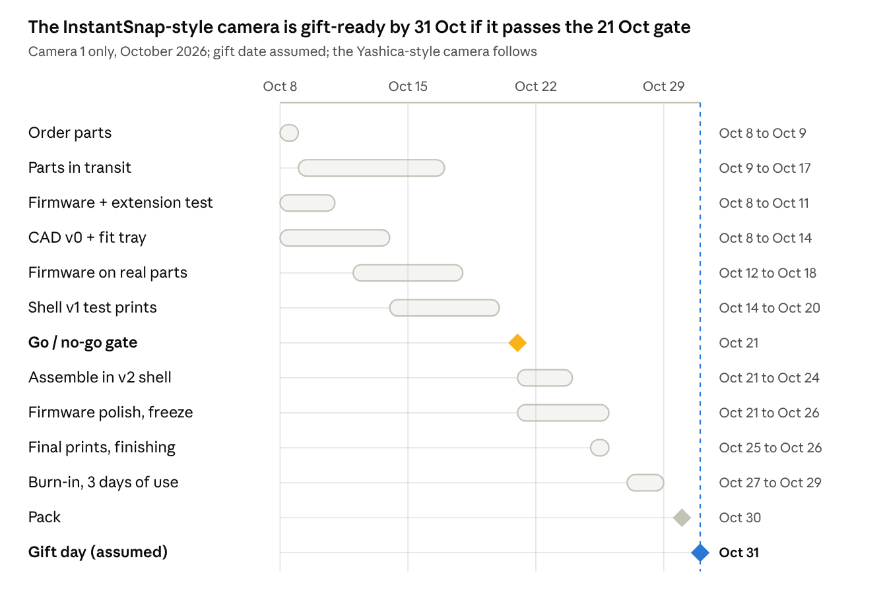
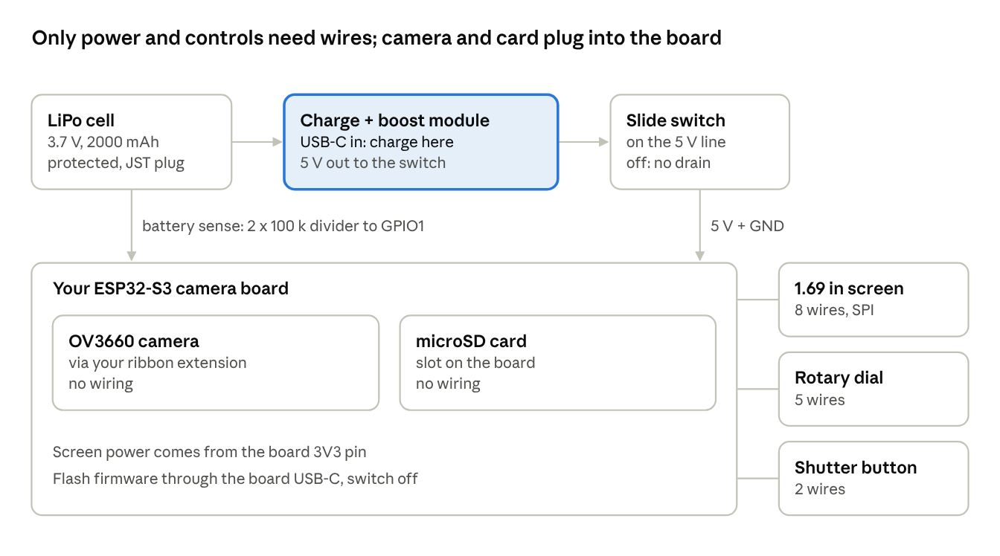

# 4-week build plan

Oct 3, 2026 · @JT

Build two different cameras on the same electronics and firmware. Camera 1 looks like the Escura InstantSnap.novo and must be gift-ready by Oct 31, 2026 (assumed date). Camera 2 looks like the Snoopy edition of the Yashica Mini, with a bigger 2.8 in screen, and follows after. Both keep the brief's key functions: photos on microSD, live preview, a gallery, and a USB-C rechargeable battery with an on/off switch, plus video as a stretch goal. Each costs about US$25–45 in parts, under buying either real camera (US$45–61). Where this tab differs from the brief, this tab wins.

## Decisions locked

The answers from 3 Oct fix most of the open questions in the brief. Fewer parts and fewer wires make a camera more reliable as a gift, so every choice leans that way.

| Topic | Decision | Why |
| --- | --- | --- |
| Two designs | Camera 1: InstantSnap.novo-style flat body. Camera 2: Yashica Mini Snoopy-style box with a bigger screen | Builder's call, 8 Oct. |
| Order | InstantSnap-style first, gift-ready by 31 Oct; Yashica-style after | Only one camera has to make the month-end date. |
| Key functions, both | Photos on microSD, live preview, gallery, battery with USB-C charging and on/off; video as a stretch | The brief's DIY requirements, unchanged. |
| Priority | Feel and finish first, then usability, then photos | Chuzhao-level images are acceptable. |
| Budget | Under US$45 per camera, all in | Must beat buying a Yashica Mini (US$45–55) or InstantSnap.novo (US$57–61). |
| Board | Your GOOUUU ESP32-S3-CAM Core N16R8 goes in the InstantSnap-style camera; buy one identical board for the Yashica-style one | Camera socket and microSD slot are built in; same pins and firmware for both. |
| Sensor | OV3660 in both | Meets the Chuzhao-level bar. |
| Lens position | Your ribbon extension lets the lens sit anywhere on the front, away from the board | Frees the layout for each design. Test it in week 1. |
| Screen | InstantSnap-style: 2.0 in IPS, 320×240 (changed from 1.69 in on 8 Oct). Yashica-style: 2.8 in IPS, 320×240 | Both are 4:3 like every photo, so pictures fill the screen with no bars, and both cameras share one 320×240 screen layout (`04-case-design.md`). 2.8 in is bigger than the Mini's 2.4 in, and its active area of about 57×43 mm (my arithmetic) fits the Mini's 73.6 mm wide back. |
| Controls | Shutter, rotary dial with push (EC11) and slide power switch, on both | One firmware, one set of habits. |
| Power | InstantSnap-style: your 2000 mAh 103450 LiPo (10×34×50 mm). Yashica-style: a second cell of similar size. Both through a USB-C charge-and-boost module (IP5306 type) to the board's 5V pin | About 4–6 hours of screen-on use (estimate; measure on the bench). |
| Power switch | Slide switch on the module's 5V output | Off means no drain; charging still works when switched off. |
| Photo transfer | Pull the microSD; a USB-C card reader goes in each gift box | Works with any phone. |
| Firmware | One ESP-IDF codebase in `firmware/`, with the screen size as a build option. Until the screen arrives, a laptop simulator (`host/`) stands in for screen, dial and shutter | Camera and SD code came from camera-test. Built and running on the board since 8 Oct (see Bench results). |
| Backup | Decide at the go/no-go gate on 21 Oct: if the InstantSnap-style unit fails, buy a real InstantSnap.novo | The fallback matches the design friend 1 is getting. |

## The two designs

The flat InstantSnap-style body is the harder fit, because the 10 mm cell and the board-plus-screen stack must sit side by side to stay thin. The Yashica-style box has room to spare.

|  | Camera 1: InstantSnap-style | Camera 2: Yashica Mini Snoopy-style |
| --- | --- | --- |
| Due | 31 Oct (assumed) | After 31 Oct; date to confirm |
| Reference size (W×D×H) | Novo: 106×16×60 mm, 38 g | Mini: 73.6×35.5×70 mm, 96–113 g |
| Our target size | About 108×20×64 mm (estimate; CAD to confirm) | About 76×38×72 mm (estimate) |
| Screen | 1.69 in, on the back | 2.8 in, filling most of the back |
| Inside layout | One layer, side by side: cell on one half; board, module and screen on the other; lens on the extension cable | Stacked: screen across the back, board and cell behind it |
| Signature details | Flat slab, see-through optical viewfinder window, swappable viewfinder frame, Y2K colours | Rounded box, Snoopy artwork, large round lens ring, wrist strap |
| Board | The one you own | Second board; order now |

Snoopy artwork is fine for a one-off personal gift. Don't sell the design or post the files publicly.

## How the finished cameras compare

Ours wins on real photo resolution, screen size, battery, live film looks, personalisation and price. It loses on thickness and weight against the Novo, and on video resolution against the Yashica's claim. Our figures are measured on the bench (8 Oct) unless marked estimate. The commercial figures come from the brief's listings and reviews; "—" means the brief found nothing published.

| | Ours: camera 1 (InstantSnap-style) | Ours: camera 2 (Yashica-style) | Escura InstantSnap.novo | Yashica Mini (Peanuts) |
| --- | --- | --- | --- | --- |
| Photos | 2048×1536 (3.1 MP, the sensor's true resolution) | Same | Sensor not confirmed; the original InstantSnap was 1.3 MP | 3–8 MP; the 8 MP figure is interpolated |
| Video | 640×480 MJPEG, about 20 fps | Same | — | 1080p claimed |
| Screen | 1.69 in, 240×280 IPS | 2.8 in, 320×240 IPS | 1.3 in, plus an optical viewfinder | 2.4 in |
| Viewfinder | See-through window, planned | No | Yes, with swappable frames | No |
| Film looks | 6, shown live in the preview | Same | Y2K and film filters | — |
| Zoom | None | None | — | 4× digital |
| Shot to shot | About 1–1.5 s | Same | — | — |
| Storage | microSD, FAT32 | Same | microSD 4–64 GB | microSD up to 32 GB |
| Battery | 2000 mAh; about 4–6 h screen-on (estimate, not yet measured) | Similar cell | — | — |
| Size (W×D×H) | About 108×20×64 mm (estimate) | About 76×38×72 mm (estimate) | 106×16×60 mm | 73.6×35.5×70 mm |
| Weight | About 90–110 g target | Similar | 38 g | 96–113 g |
| Personal touches | Your design, their name, custom boot screen, named looks; screwed shell, so it can be repaired and re-shelled | Same | No | Licensed artwork |
| Price | About US$11–16 of new parts | About US$28–45 | US$57–61 | US$45–55 |

**Possible upgrade: HD video.** The OV3660 can output 1280×720, but 720p MJPEG needs roughly 1 MB/s to the card. This card currently takes about 0.34 MB/s. Getting there needs a faster card plus the buffered video writer described in `03-how-it-works.md`. It's untested, so it isn't promised.

## Timeline

Firmware and CAD run while parts ship. Everything after 21 Oct depends on the bench unit passing the gate. The Yashica-style camera starts after gift day, so it can't delay the first one.

## Week by week

Everything below is for the InstantSnap-style camera, except the last block. Firmware, the extension test and CAD start now, while parts ship.

**8–11 Oct: order, test what you have, start CAD**

- [ ] Order today: charge module, 1.69 in screen, EC11, 12×12 switch, slide switch, JST-SH plugs, M2 inserts, vinyl sticker sheet (Parts table). Try Singapore sellers first for the module and screen; use Taobao only if it can arrive by 17 Oct.
- [ ] In the same order, add the second board and the 2.8 in screen for the Yashica-style camera.
- [ ] Check the 2000 mAh cell: measure its voltage and polarity with a multimeter and confirm it has a protection board. Then store it away from metal until the charge module arrives. Don't connect it to the board.
- [x] Camera firmware in `firmware/` plus the laptop simulator in `host/`. Preview, photos, video, gallery, delete, film looks and power all work on the board (8 Oct).
- [ ] Extension test: run camera-test with the camera on the extension cable. Look for streaks, colour noise or failed captures. If they appear, lower the camera clock (XCLK) in camera.c and retest.
- [ ] Measure current draw from USB with a USB power meter, during preview and during a capture.
- [ ] CAD v0: measure the board, cell, camera module and extension with calipers. Lay them out flat inside a 108×64 mm outline and check that 20 mm thickness works.
- [ ] Print a flat fit tray (a 2 mm plate with pockets for each part) to prove the side-by-side layout before designing the shell.

**12–18 Oct: parts arrive, working bench unit**

- [ ] Bring up the 1.69 in screen; re-lay out camera-test's camera, gallery and settings screens for 240×280.
- [ ] Add the shutter button and the film looks.
- [ ] Battery chain on the bench: cell, module, switch, board. Test charging, the GPIO1 voltage reading and the low-battery warning, and that the board boots with no button press on the module.
- [ ] Shell v1 at draft quality, with the viewfinder window, lens ring and control cut-outs.

**19–24 Oct: gate, then assemble**

- [ ] **Go/no-go on Wed 21 Oct.** Go means the bench unit shoots, saves, previews, plays back and runs on battery, and a v1 shell closes over it. No-go means ordering a real InstantSnap.novo that day.
- [ ] Assemble in the v2 shell; fix what it reveals.
- [ ] Firmware polish: boot splash, look names, low-battery screen, delete with confirmation.

**25–31 Oct: finish, burn in, wrap**

- [ ] Final prints in final colours (25–26 Oct); colour panels, viewfinder frame, strap.
- [ ] Freeze the firmware on 26 Oct.
- [ ] Burn-in, 27–29 Oct: three days of real use (see Gift-ready checklist).
- [ ] Fix only what the burn-in breaks; pack on 30 Oct.

**Yashica-style camera, from 1 Nov**

- [ ] Same firmware built for 320×240; bring up the 2.8 in screen.
- [ ] New shell CAD in the stacked layout, with Snoopy artwork; same finish rules.
- [ ] Same Gift-ready checklist before wrapping.

## Parts and cost per camera

Camera 1 needs only about US$11–16 of new parts, because you already own its board, camera, extension, cell and SD card. Camera 2 needs about US$28–45, mostly the second board and the 2.8 in screen. Shipping and tools are extra, and all prices are estimates.

| Part | Search terms or source | Camera 1: InstantSnap-style | Camera 2: Yashica-style | Est. per camera (US$) |
| --- | --- | --- | --- | --- |
| GOOUUU ESP32-S3-CAM Core N16R8 | Same listing as yours | Owned | Buy 1 | 7–12 |
| OV3660 camera | `OV3660 摄像头模组 24P` | Owned, with extension | Buy 1 only if board 2 ships with an OV2640 | 0–3 |
| USB-C charge + boost module, 5V out, IP5306 type, about 1 A, always-on | `Type-C 充电升压一体模块 5V IP5306 常开` | 1 + 1 spare | 1 | 0.5–1 |
| LiPo 3.7V, protected, JST-PH2.0 | Singapore seller | Owned: 2000 mAh 103450 | Buy 1, similar size | 4–6 |
| 2.0 in IPS screen, 320×240, ST7789, SPI | `2.0寸 IPS 彩屏 ST7789 240x320 SPI` | 1 + 1 spare | — | 3–5 |
| 2.8 in IPS screen, 320×240, ST7789, SPI | `2.8寸 IPS 彩屏 ST7789 240x320 SPI` | — | 1 | 4–7 |
| Rotary encoder with push, EC11, D-shaft | `EC11 旋转编码器 带开关` | 1 + 1 spare | 1 | 0.5 |
| Shutter switch 12×12 mm + slide switch | `轻触开关 12x12`, `微型拨动开关 MSK12C02` | 1 pack each, shared |  | 0.5 |
| JST-SH 1.0 mm 8-pin plug pairs | `JST SH1.0 8P 对插线` | 1 pack, shared |  | 0.5 |
| microSD 16–32 GB | `32GB microSD Class10` | Owned | Buy 1 | 3–5 |
| USB-C microSD reader, for the box | `Type-C TF读卡器 迷你` | 1 | 1 | 1–2 |
| Printable vinyl sticker sheet, for artwork | `可打印 防水 贴纸 A4` | Optional accents | Snoopy wrap | 1–2 |
| M2 heat-set inserts + M2×6 screws | `热熔铜螺母 M2`, `M2 螺丝` | 1 pack each, shared |  | 1 |
| 100 k and 10 k resistors, 30AWG wire, heat shrink, Kapton | `电阻 100K`, `30AWG 硅胶线`, `热缩管`, `高温胶带` | 1 set, shared |  | 0.5 |
| Filament, PETG | Owned | About 60–80 g | About 90–120 g | 1–2.5 |
| Wrist strap, small gift box, printed card | `相机手腕带`, `礼品盒 小号` | 1 | 1 | 2–3 |

Buy the LiPo cells locally. Taobao's air consolidation to Singapore prohibits batteries, and sea freight is too slow for this deadline ([you.co](https://www.you.co/sg/blog/taobao-shipping-prohibited-items)). The spare screen, cell and encoders cover one broken part without a re-order.

From the brief's list, drop the 0.96 in TFT and the 6×6 button pack, which the new screens and the dial replace. Leatherette is out: the InstantSnap style is smooth colour-blocked plastic, and the Snoopy style uses a printed vinyl wrap.

## Connections and charging

The camera and microSD card need no wiring: the camera's ribbon plugs into a socket and the card slot is on the board. The only wiring is the battery's power chain and the three controls.

The board has no battery charger and expects 5V, like a USB port. A LiPo gives 3.0–4.2V. That is too low for the board's 5V input and too high to wire straight to its 3.3V pin. The module bridges the gap: it charges the cell from USB-C and boosts it to a steady 5V.

**How to recharge:** plug any USB-C charger or cable into the module's port, not the board's. It charges whether the switch is on or off. The module's LEDs show charging and full, so give them a small window or light pipe in the case. Your 2000 mAh cell at about 1 A takes roughly 2.5–3 hours (estimate).

| Link | How it connects | Wires |
| --- | --- | --- |
| Camera to board | Camera ribbon into the extension's socket, then the extension into the board's socket. At each one: flip up the latch, slide the ribbon in fully with the contacts facing the pins, press the latch down | 0 |
| microSD to board | Slot on the board; leave a slot opening on the case edge | 0 |
| Cell to module | Cell's JST plug into a pigtail soldered to the module's B+ and B− pads, so the cell can be unplugged | 2 |
| Module to board | Module OUT+ to slide switch to board 5V pin; module OUT− to board GND | 3 |
| Battery sense | Cell + to 100 k to GPIO1, and 100 k from GPIO1 to GND | 3 short |
| Screen to board | VCC to 3V3, GND, SCL to SCK, SDA to MOSI, CS, DC, BLK to a pin; RES to the board's EN pin | 8 |
| Rotary dial | A, B and push to pins; the common and switch legs to GND | 5 |
| Shutter | One leg to a pin, the other to GND | 2 |

Rules that keep it safe and tidy:

- Check the cell's polarity with a multimeter before plugging it in. JST plugs from different sellers are often wired in reverse.
- Never connect the cell directly to the board's 5V or 3V3 pins.
- The module's charge current should not exceed the cell's capacity: about 1 A for a 1000 mAh cell. Too high a current is why a 500 mAh cell is a poor match for these modules.
- Some modules need a button press to turn the output on. On the bench, flip the switch and confirm the board boots without one. If it doesn't, buy the "always on" (常开) variant.
- Desolder the board's pin headers, or buy it without headers, and solder 30AWG silicone wire straight to the pads. Use heat shrink on every joint. Tack wire bundles down with Kapton or hot glue so nothing pulls on a joint.
- Put a small JST-SH connector between the screen and the board, so the back shell can come off without cutting wires.
- Before flashing firmware over the board's own USB-C, switch the camera off, so the module and the USB port don't both feed 5V.
- Your ribbon extension lets the lens sit anywhere on the front. Bend it gently, never crease it, and clamp it in the carrier so it can't pull out of either socket.

## Pin plan

Your board is the GOOUUU ESP32-S3-CAM Core N16R8, the same one your lovebox firmware uses (firmware/camera-test/main/pins.h). The screen and dial keep camera-test's pins, so its code carries over; only the shutter and battery sense are new.

| GPIO | Connects to | Notes |
| --- | --- | --- |
| 42 | Screen CS | Same as camera-test |
| 41 | Screen DC | Same as camera-test |
| 21 | Screen SCK | Same as camera-test |
| 47 | Screen MOSI | Same as camera-test |
| 46 | Screen backlight | PWM for dimming; lovebox uses this pin for its backlight |
| EN pin | Screen RST | Resets with the board; firmware sends a soft reset, as lovebox does |
| 2 | Dial A | Same as camera-test |
| 45 | Dial B | Same as camera-test; strapping pin, safe on this module (see pins.h) |
| 14 | Dial push | Same as camera-test |
| 48 | Shutter | Shared with the onboard RGB LED; switch the LED off at boot, as lovebox does. The LED may flicker on presses, hidden inside the case |
| 1 | Battery sense | ADC; middle of the two 100 k resistors |
| 5V and GND | Module output, through the switch |  |
| 3V3 | Screen VCC |  |
| Do not use | 0 and 3 (strapping; 3 is not on the headers), 4–13 and 15–18 (camera), 38–40 (microSD), 35–37 (PSRAM), 19–20 (USB), 43–44 (serial) | From pins.h |

The microSD slot is on the board, wired to GPIO38–40 by its own traces, so it never shares the screen's pins. Every usable pin is now taken.

## Firmware spec

The camera has three screens (preview, gallery and charging) driven by a shutter button and one dial. A friend should be able to use it without reading the card.

| Control | In preview | In gallery |
| --- | --- | --- |
| Shutter | Photo mode: take a photo (white flash, then back to preview). Video mode: start or stop recording | Back to preview (or cancel a delete) |
| Dial turn | Change the film look; its name shows for 1 s | Previous or next photo or video; videos play by themselves |
| Dial press | Open the gallery at the newest item | Back to preview (or confirm a delete) |
| Dial long press | Switch between photo and video mode | Delete this item, after a confirm press |

A dimmed screen brightens and still acts on the press; a sleeping screen (after 2 min) only wakes. These rules are live in the simulator, so they can be tried before the hardware exists.

**Film looks cost no processing time.** They are presets of the sensor's own settings (special effect, saturation, contrast, white balance) in esp32-camera, so the preview shows exactly what gets saved. A starting set:

1. Natural: defaults.
2. Warm film: cloudy white balance, saturation +1.
3. Faded: contrast −2, saturation −1, brightness +1.
4. Mono: grayscale effect, contrast +2.
5. Sepia: sepia effect.
6. Cool: office white balance, saturation −1.

Must have for 26 Oct:

- [x] Boot to live preview in a few seconds, through a personal splash screen (simulator).
- [x] Full-resolution JPEG (2048×1536) saved to `/DCIM/DSC_0001.JPG` onward. The number comes from scanning the card at boot rather than NVS, so swapping cards never overwrites a photo.
- [x] Gallery, newest first, with photos and videos (simulator; the on-screen version comes with the screen).
- [ ] Battery icon from the GPIO1 reading; a warning at low charge and a clean shutdown before the cell cuts out.
- [x] Screen dims after 30 s idle and turns off after 2 min; any button wakes it (simulator).
- [x] Power-loss-safe saves (temp file, then rename) for photos and videos; a half-written temp file is removed at boot.

Stretch, only if week 3 ends early:

- USB drive mode: plugged into a laptop, the SD card appears as a drive (ESP32-S3 native USB).
- Done early: video as 640×480 MJPEG AVI, up to 10 minutes per clip. Verified with ffmpeg (clean decode) and in the simulator; VLC plays MJPEG AVI.

**Bench results, 8 Oct** (board on USB power, 1 GB card):

| Measure | Result |
| --- | --- |
| Live preview | 320×240 at 27.8 fps from the sensor |
| Photo | 2048×1536 JPEG, 170–460 KB; capture 0.4 s plus save 0.6–1.0 s |
| Video | 640×480 MJPEG at 19–22 fps, about 0.28 MB/s (about 55 min of video per GB) |
| SD writes | First at about 120 KB/s, because the SD driver can't DMA from PSRAM. Fixed by copying through a 16 KB internal-RAM buffer: about 4× faster |
| USB link to laptop | 1.5 Mbaud (2 Mbaud dropped bytes on the CH340); about 120 KB/s, so a 1.7 MB video takes about 15 s to reach the simulator |

Left out of v1: a date stamp. There is no clock that survives the power switch, and no pin left for an RTC module.

## Case and finish spec

What separates a gift from a project is a handful of details: no visible layer lines, no rattles, controls that click, and a surface finish that looks deliberate. Each one below is cheap.

**InstantSnap-style specifics (camera 1)**

*Superseded by `04-case-design.md` (8 Oct): a clear-sandwich body of 116 × 66 × 15.2 mm, with three back buttons (◀ ● ▶) in place of the dial. The points below still apply where they don't conflict.*

- Flat slab with rounded corners, colour-blocked in two or three Y2K colours printed as separate panels.
- See-through optical viewfinder: a straight tunnel through the body beside the lens, open or with clear acrylic windows. Reserve its space first in the CAD, since it competes with the cell for room.
- Swappable viewfinder frame: a small printed bezel that clips or magnets onto the viewfinder, so your friend can change it.
- Lens in a printed lens ring on the front, on the extension cable.
- The charge module's LEDs show through a small light pipe on an edge.

**Yashica Snoopy-style specifics (camera 2)**

- Box with generous corner radii; the 2.8 in screen centred on the back with a thin bezel.
- Large round lens ring on the front; Snoopy artwork on a printed vinyl wrap.
- Dial and shutter on top, laid out like camera 1's.

**Structure**

- Two-part clamshell (front and back) plus an internal printed carrier that holds the board, the charge module, the screen and the cell. Nothing floats on wires.
- Four M2 heat-set inserts in the front shell, with M2×6 screws from the back. No glue on electronics, so a unit can be opened, repaired or re-shelled.
- Foam pad or Kapton around the cell, with no sharp printed edges touching it.
- Clearances: 0.2 mm around button caps and the dial, 0.3 mm around the screen and the USB-C opening. Print a clearance test coupon first.

**Surfaces**

- PETG for the final shells. PLA softens at around 55–60°C, which a car in Singapore can exceed. PLA is fine for test prints.
- Print the front and back faces face-down. On a textured PEI plate this gives an even, factory-like grain with no layer lines on the parts people touch.
- Use 0.12–0.16 mm layers for curved top surfaces, 4 walls, and place the seam on a hidden edge.
- Any wrap or sticker panel sits in a 0.3–0.5 mm recess, so its edges can't lift or peel.
- A second colour for the accents: lens ring, dial knob and shutter cap. Print them as separate parts, so no multi-colour printer is needed.

**Controls and openings**

- Dial: an EC11 under a knurled printed knob, about 18–20 mm across, on the top plate. This is the Chuzhao touch.
- Shutter: a 12×12 mm switch under a domed cap with a flange that stops it falling out.
- Slide switch recessed on the side, so it doesn't switch on in a bag.
- USB-C opening and microSD slot on the edges. A fingernail notch beside the card slot.
- Strap lug: a solid printed loop at least 3 mm thick, or a metal strap eyelet set into the shell.

**Weight**: aim for about 90–110 g, close to the Yashica Mini's 96–113 g, because a very light camera feels cheap. If the build comes in under about 80 g, raise the infill or add a steel washer in the base.

## Personalisation

Both cameras share electronics and firmware; only the shells differ. Each one becomes personal through colour, text and screens, which costs no extra engineering.

| Touch | Camera 1: InstantSnap-style | Camera 2: Yashica Snoopy-style |
| --- | --- | --- |
| Shell and accent colours |  |  |
| Wrap or sticker artwork |  |  |
| Name or initials debossed on the base |  |  |
| Boot splash image |  |  |
| Names for the film looks (an in-joke works) |  |  |
| Welcome photo preloaded on the card |  |  |

Because the shell is screwed together, a friend can get a new shell later without touching the electronics. Keep the CAD parametric, with the text and colours as variables.

## Gift-ready checklist

No camera gets wrapped until it passes every line below; camera 1's burn-in runs 27–29 Oct.

- [ ] 200 photos per unit across all six looks, with no crash, freeze or unreadable file.
- [ ] Switch off mid-save 10 times; the card still mounts and older photos open.
- [ ] Full charge from flat, overnight; record hours to full and hours of use.
- [ ] One full day carried in a bag: it doesn't switch on by itself, nothing rattles, nothing loosens.
- [ ] Drop from 1 m onto carpet: it still works and the shell stays closed.
- [ ] Cell stays cool while charging and shooting. Charge only while someone is nearby.
- [ ] Cards read on an iPhone and an Android phone through the USB-C reader.
- [ ] Screws snug, no sharp edges, sticker and wrap edges stuck down.

In each box:

- [ ] Camera, charged, card inserted with the welcome photo
- [ ] Wrist strap, fitted
- [ ] USB-C microSD reader
- [ ] A short USB-C cable
- [ ] A printed card: how to switch on, charge (plug USB-C into the charging port, about 3 hours, switch on or off), use the dial, and get photos onto a phone

## Risks and fallbacks

The deadline is the biggest risk, and the 21 Oct gate exists to catch it early.

| Risk | Early warning | Fallback |
| --- | --- | --- |
| Parts arrive late | Not arrived by 17 Oct | Buy the board and screen from a Singapore reseller and pay more |
| Firmware not ready | Gate fails on 21 Oct | Buy a real InstantSnap.novo for friend 1; finish the DIY later |
| Camera unreliable on the extension | Streaks, noise or failed captures in the 8–11 Oct test | Lower XCLK in camera.c; reseat both sockets; or drop the extension and place the lens over the board |
| Charge module won't power the board | Board doesn't boot when switched on, or resets on the shutter | Always-on module variant; add a 470 µF capacitor across the board's 5V and GND |
| Case fit takes several rounds | v1 shell doesn't close | Draft prints at 0.28 mm; parametric CAD; clearance coupon first |
| Cell damage or swelling | Warm or puffy cell | Protected cells only, padding, no pressure on the cell; replace with a spare |

## Open questions

- [ ] Exact gift date. The plan assumes 31 Oct.
- [ ] Board confirmed as the GOOUUU ESP32-S3-CAM Core N16R8. When the screen arrives, check its pin labels against the pin plan.
- [ ] Does your printer have a textured PEI plate, or multi-colour?
- [ ] Colour and name choices for each camera (Personalisation table), and when the Yashica-style camera is due.

## Sources

- [The Pi Hut XIAO ESP32S3 Sense listing](https://thepihut.com/collections/seeed/products/seeed-studio-xiao-esp32s3-sense): XIAO price, for comparison.
- [Waveshare 1.69 in LCD module](https://www.waveshare.com/product/displays/lcd-oled/1.69inch-lcd-module.htm): 240×280, ST7789V2, module size.
- [you.co: Taobao shipping prohibited items](https://www.you.co/sg/blog/taobao-shipping-prohibited-items): batteries barred from air consolidation to Singapore.
- Brief tab: commercial camera prices, battery current, prior-art projects.
