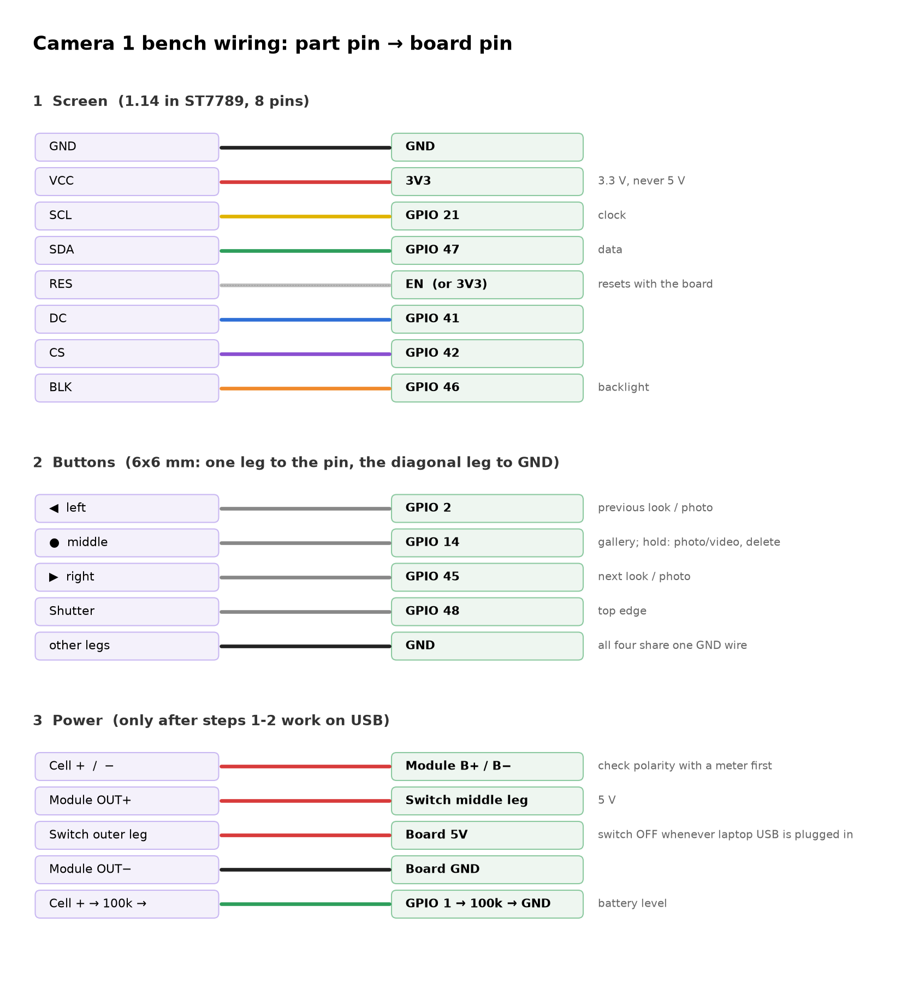

# Camera 1 bench bring-up: wiring and testing the whole pipeline

10 Oct 2026. All parts are in except the 2.0 in screen, so this uses the **1.14 in 240 × 135 ST7789** for now. Everything here works the same with the 2.0 in later; only the screen size in the firmware and the case parameters change.

**Firmware 0.2.0 runs the camera on its own:** live view on the screen, shutter, the three back buttons, gallery with video playback, battery gauge, dim after 30 s and sleep after 2 min. The laptop simulator still works alongside it.

## The plan in one line

Test with jumper wires while the headers are still on, one part at a time (screen, then buttons, then battery), and only then take the headers off and hard-wire for the case.

Headers exist for exactly this stage, and a fault is far easier to find on jumpers than inside a closed case.

## Wiring



You need female-to-female jumper wires (Dupont) for the headers, a multimeter, and two 100 kΩ resistors.

| Part pin | Board pin | Notes |
| --- | --- | --- |
| **Screen** GND | GND | |
| VCC | 3V3 | Never 5 V |
| SCL | GPIO 21 | Clock |
| SDA | GPIO 47 | Data |
| RES | EN (labelled RST on some boards) | Or 3V3 if there's no EN pin; the firmware also sends a soft reset |
| DC | GPIO 41 | |
| CS | GPIO 42 | |
| BLK | GPIO 46 | Backlight, dimmable |
| **◀ button** | GPIO 2 | Other leg to GND |
| **● button** | GPIO 14 | Other leg to GND |
| **▶ button** | GPIO 45 | Other leg to GND |
| **Shutter** | GPIO 48 | Other leg to GND. Shares a pin with the onboard RGB LED, so that LED may blink when you press it. Harmless |
| **Cell** + / − | Charge module B+ / B− | Check polarity first (step 3) |
| Module OUT+ | Slide switch middle leg → switch outer leg → board 5V | |
| Module OUT− | Board GND | |
| **Battery sense** | Cell + → 100 kΩ → GPIO 1 → 100 kΩ → GND | Lets the camera read the cell voltage |

**6 × 6 mm buttons:** the four legs are two pairs that are always joined. Wiring two diagonally opposite legs always gives you the switch, whichever way it's turned.

## Laying it out on the desk

```
 [camera on ribbon]                                   [breadboard]
        |                                      ◀  ●  ▶  shutter  (across the centre gap)
 [ESP32 board] ==F-F jumpers==> [1.14in screen]   GND rail ── every button's other leg
        |  \=====M-F jumpers=======================> button pins, GND rail, GPIO1
     USB-C to laptop                              [charge module]  2 × 100k divider
                                                  [cell, via a JST socket pigtail]
```

- **Board stays off the breadboard.** It's too wide (it would cover both sides) and the camera ribbon needs room. Leave it flat on the desk, camera side up, and run jumpers from its header pins.
- **Screen:** 8 female-to-female jumpers straight from its header to the board's header.
- **Buttons, charge module, resistors:** on a breadboard, joined to the board with male-to-female jumpers.
  - The 6 × 6 buttons straddle the centre gap.
  - The module's pins plug straight into the breadboard.
  - Use the breadboard's long rail as the shared GND.
- **Cell:** don't push jumper pins into its JST plug, because they sit loose and a LiPo short is the one real danger here. Use a matching JST socket pigtail plugged into the breadboard, or solder the module's B+/B− wires now.
- **Slide switch:** skip it on the bench. Plugging and unplugging the module's OUT+ wire does the same job.
- Wire with USB unplugged, every time. Plug in only to test.

## Step 0: flash the new firmware (board only, nothing wired)

Plug the board's USB-C into the laptop, then:

```bash
cd ~/Development/engineering/digicam/gift-cameras/firmware && source ~/Development/esp-idf-v5.5.4/export.sh && idf.py -p /dev/cu.wchusbserial10 flash
```

Or ask me and I'll flash it. With no screen fitted the camera still runs and draws to its framebuffer. This command saves a picture of what the screen *would* show, which checks the interface before any wiring:

```bash
cd ~/Development/engineering/digicam/gift-cameras/host && .venv/bin/python bench.py shot
```

Stop the simulator before using `bench.py`, because only one program can hold the serial port.

## Step 1: screen

1. Unplug USB. Wire the 8 screen wires. Plug USB back in.
2. **Expected:** "digicam / ready when you are" for about a second, then the live view in the middle of the screen with a column each side: mode and look dots on the left, battery and shots left on the right.

| What you see | Fix |
| --- | --- |
| Backlight on, screen black or noise | Check SCL, SDA, DC and CS. Then try RES on 3V3 instead of EN |
| Picture shifted, with a stripe of noise along one edge | RAM offset. Try `bench.py lcd 1 1 0 40 52 1` (the last-but-one number moves it by a pixel) |
| Upside down | `bench.py lcd 1 0 1 40 52 1` |
| Colours look like a negative | `bench.py lcd 1 1 0 40 53 0` |
| Red and blue swapped | Tell me: it's a one-line firmware change |
| Flashing fails with the screen connected ("wrong boot mode", or no sync) | The screen's BLK input holds GPIO 46 high, a boot pin. Unplug the BLK wire while flashing |

`lcd` changes last until a restart. Once you find the right numbers, tell me and I'll make them the default.

## Step 2: buttons

1. Wire the four buttons (one leg to the pin, the diagonal leg to a shared GND).
2. Run `bench.py log 60` and press each button. Each press prints a line such as `button: left`. "hold" appears when ● is held for 0.6 s.
3. Then test what they do:

| Try | Expected |
| --- | --- |
| ◀ / ▶ in live view | Look name pops up at the bottom; the lilac dot moves |
| Shutter | White flash, "saving...", then the file name (DSC_0042) |
| ● | Gallery, newest first. ◀ ▶ step through. ● or shutter goes back |
| Stop on a video in the gallery | Starts playing on its own after 0.7 s, looping |
| Hold ● in the gallery | "Delete?". ● deletes; any other button keeps it |
| Hold ● in live view | Mode dial: Photo / Video / Settings. ◀ ▶ choose, ● picks |
| Mode dial → Settings | Self-timer, grid, brightness, sleep time, format card, About. ◀ ▶ move, ● changes, shutter goes back |
| Shutter in VID | Red dot and timer; shutter again stops and saves |

A warning in the log such as "GPIO45 reads pressed at start" means that pin is shorted to GND: check the button's legs.

## Step 3: battery and power

1. **Check the cell's polarity** with the multimeter on the JST plug: red should read +3.7 to 4.2 V against black. Sellers do ship reversed plugs.
2. Connect the cell to the charge module's B+ / B−. Measure the module's OUT+ to OUT−: it should read 5.0–5.2 V. If it reads nothing, press its button once; if it needs that every time, it's the wrong variant for a camera.
3. Plug a USB-C charger into the **module**: its charging LED should light.
4. Add the two 100 kΩ resistors. With the slide switch **off** and the laptop plugged into the board, run `bench.py status`: `"battery"` should read something like `"78% (3.95 V)"`, within about 0.05 V of the multimeter.
5. Unplug the laptop and slide the switch **on**: the camera should boot from the battery. Record a minute of video, the heaviest load. If the camera restarts when recording starts, the module is sagging under peak current: add a 470–1000 µF capacitor across the board's 5V and GND.
6. Optional, for battery life: put the multimeter (mA range) in series on the 5 V wire between the switch and the board. Expect roughly 250–350 mA in live view. Hours ≈ 2000 mAh × 3.7 V × 0.85 ÷ (5 V × current in A); at 300 mA that's about 4 hours of live view.

**Rule:** keep the slide switch **off** whenever the laptop is plugged into the board, so the module and the laptop never both feed 5 V.

## Step 4: whole-pipeline check

On battery, with no laptop:

- [ ] Boots in under 3 s to the live view
- [ ] 10 photos in a row; each shows its name, then appears in the gallery
- [ ] 1-minute video; plays back in the gallery; copy the card to the laptop and open the AVI
- [ ] All six looks change the live view
- [ ] Delete from the gallery works and the count drops
- [ ] Dims after 30 s, screen off after 2 min, and any button wakes it (that press only wakes)
- [ ] Battery % falls slowly over a session; charging from the module's USB-C works with the switch off

## The pre-soldered headers: take them off

**Recommendation: after the bench tests pass, remove the headers from all three boards and solder thin wire straight to the pads.** No case redesign is needed for this: the case model already assumes no headers.

**Why keeping them doesn't work:** each header adds about 8.5 mm (2.5 mm plastic spacer plus 6 mm of pin). The case's 12 mm cavity holds the board (7 mm) with the screen stacked on it (4.5 mm), with 0.5 mm to spare. Headers on the board alone would make the camera about 23 mm thick instead of 15. Jumper plugs on top would add even more, and in a clear case they look like a prototype.

### How to remove them without damaging the pads

**Camera board (two rows of about 20 pins): cut the pins, don't pull them.** You only need about 15 of the 40 pins: 5V, GND ×2, 3V3, EN, and GPIO 1, 2, 14, 21, 41, 42, 45, 46, 47, 48.

1. Lever the black plastic spacer off the pins with a small flat screwdriver, working along it a little at a time. If it won't slide, snip it between the pins so each pin stands alone.
2. Cut every pin flush with the board using flush cutters.
3. Add flux and a touch of fresh solder to each stub and reflow it into a low dome. That dome is the pad you solder a wire to.

No pulling means no lifted pads. That's the main way people ruin these boards.

**Screen (8 pins) and charge module (4–6 pins):** few pins, so remove them properly.

1. Cut the plastic spacer off.
2. Heat each pin's joint (flux first) and pull the pin out with tweezers from the other side.
3. Clear the holes with solder wick so the wires can go through them, which is stronger than a wire laid on top.

**Tools:**
- iron at about 340 °C with leaded solder;
- flux pen;
- 2 mm solder wick;
- flush cutters, tweezers;
- 1.5 mm heat shrink;
- Kapton tape.

### Wiring it cleanly (it's on show in a clear case)

- **Wire:** 30 AWG silicone wire. It's thin, flexible and doesn't melt back from the iron. In a clear case it looks better in **two colours only**: white for signals, black for GND and power (or the case's lilac for signals). Rainbow jumper colours make it look like a breadboard.
- **Lengths:** cut each wire to its route plus 10 mm. No loops.
  - The screen sits directly on the board, so its 8 wires are only 15–25 mm long.
  - Twist the screen bundle loosely and fold it flat along the board's edge.
- **Buttons:** solder the three 6 × 6 buttons onto a small strip of perfboard, with one GND rail on the back. They stay aligned and there's one 4-wire bundle to the board instead of seven loose wires.
  - Perfboard holes are 2.54 mm apart, so set the Fusion parameter `btn_pitch` from 12 mm to **12.7 mm** (five holes) and the caps will line up exactly.
- **Screen swap later:** the 2.0 in screen replaces the 1.14 in. Put an 8-pin **JST-SH (1.0 mm)** connector pair in the screen bundle, so the swap is unplug-and-plug instead of eight joints to redo.
- **Battery:** keep its JST plug and solder the matching socket to the module, so the cell can always be disconnected.
- **Strain relief:** every joint gets heat shrink. Tack each bundle down with a dot of hot glue or Kapton near the joint, so tugs land on the glue, not the pad.

### Case changes worth making (small)

None are needed to fit the parts. These make the wiring tidier:

1. **Wire channels:** a 2 × 2 mm groove along the inside of the frame wall from the battery side to the board, so the power wires run hidden along the edge instead of across the clear plate.
2. **Wire clips:** two or three printed hooks on the frame floor next to the board, to hold the screen and button bundles flat.
3. **`btn_pitch` = 12.7 mm** if you use the perfboard button strip.
4. **Screen pocket:** if the 2.0 in doesn't arrive by about 21 Oct (the go/no-go date), set the screen parameters in Fusion to the 1.14 in module's measured size, and the firmware's `LCD_W`/`LCD_H` stay as they are now.

Measure the board once the headers are off: its real height (`board_T`) and where the USB-C and SD slot sit on its edges. Those are the last numbers the case needs before the first full print.

## Laptop bench tools

`host/bench.py` talks to the camera over the board's USB port. Stop the simulator first.

| Command | Does |
| --- | --- |
| `bench.py shot [file.png]` | Saves the screen's contents as a PNG, 3× size (works with no screen fitted) |
| `bench.py btn left\|right\|ok\|hold\|shutter` | Presses a button from the laptop |
| `bench.py status` | Camera, card, battery voltage, memory |
| `bench.py log [seconds]` | Prints the camera's log; real button presses show up here |
| `bench.py lcd SWAP MX MY GX GY INV` | Orientation and offset for a screen module |

## Screens (firmware 0.3.0)

Every screen, rendered on the laptop by the firmware's own drawing code: `firmware/sim/out/sheet.png` (run `firmware/sim/render.sh` after changing `main/ui_draw.c`).

## What changed in the firmware (0.2.0)

| File | What |
| --- | --- |
| `display.c/.h` | ST7789 through ESP-IDF's `esp_lcd`, a 240 × 135 framebuffer, text (Spleen bitmap font from the lovebox project), shapes, and JPEG-to-screen. The JPEG is decoded at 1/1, 1/2, 1/4 or 1/8 scale, whichever still covers 180 × 135, then resampled |
| `ui.c/.h` | The screen layout, drawn by its own task on core 0, so screen updates never slow the camera on core 1 |
| `buttons.c/.h` | Polls the four buttons every 10 ms. A press must hold for 30 ms to count, to ignore contact bounce. ◀ ▶ repeat when held; ● sends a press on release, or a hold at 0.6 s |
| `battery.c/.h` | ADC on GPIO 1 with the chip's calibration, averaged and smoothed, mapped to % with a LiPo curve. Stops a recording cleanly below 3.35 V so the video is saved before the module cuts power |
| `main.c` | Button handling, the on-camera gallery and video playback, idle dim/sleep, new link commands `btn`, `shot` and `lcd`. The laptop stream now starts only when the simulator says hello |
| `personal.h` | `OWNER_NAME`: set it before flashing each friend's camera, for "hi, name" on the start-up screen |
