# Camera 1 assembly guide

11 Oct 2026, for the v2 test-fit body (`cad/camera1_v2.scad`).

**Interactive 3D version:** https://claude.ai/artifact/F3JXrfZqLtduQ8skmWP6sQ. Parts fly into place step by step, and you can turn the model, pull it apart, or hide the case to see the wiring. Local copy: `guide/index.html`. To run it locally, start a web server in `guide/` (`python3 -m http.server 8766`) and open http://127.0.0.1:8766.

The images below are stills of the same 14 steps, from `guide/steps/`. Wire positions along the board's edges are only a guide: solder to the pins printed on your board, as in `diagrams/wiring-bench.png`. Screw sizes, the hardware list and print settings are in `04-case-design.md`.

**Rebuilding the guide after a model change:**

1. Run `cad/export_guide.py`. It exports every part from `cad/guide_parts.scad` and bundles them into `guide/models.json`.
2. Republish the page.

## 1. All the parts

The whole camera pulled apart: back plate, frame, sled with the screen and board, front plate, and every screw and insert.

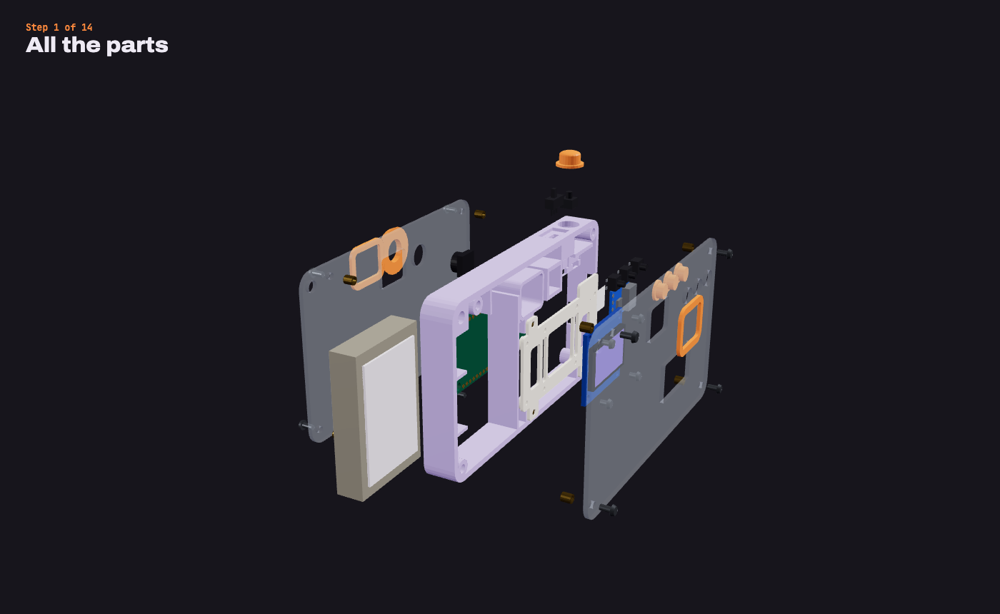

## 2. Press in the inserts

11 M2 heat-set inserts: one from each face of the four corner posts (8), and one in each of the three blocks the sled rests on.

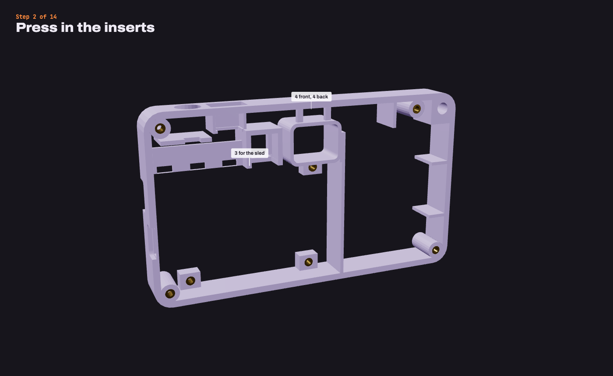

## 3. Screw the screen to the sled

Screen header removed, glass toward the back, wire pads over a slot; 4 × M2×3 from the glass side.

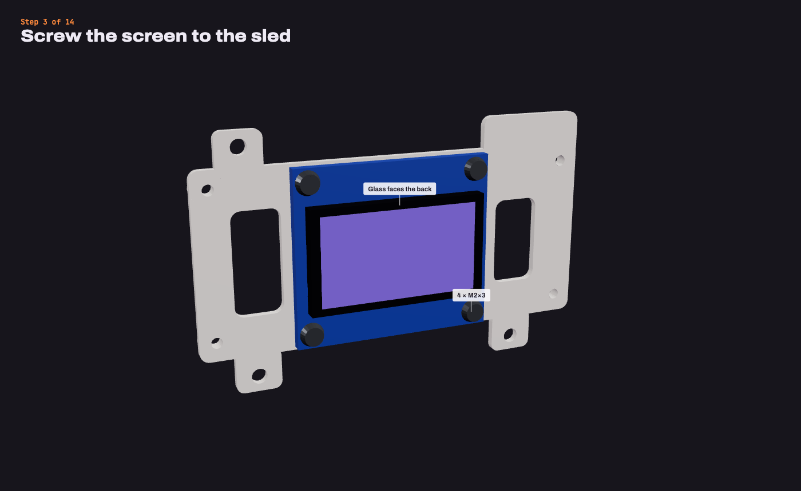

## 4. Screw the board to the other side

Board on the four raised pads, components toward the front; M2×4 in three corners, M2×3 top right.

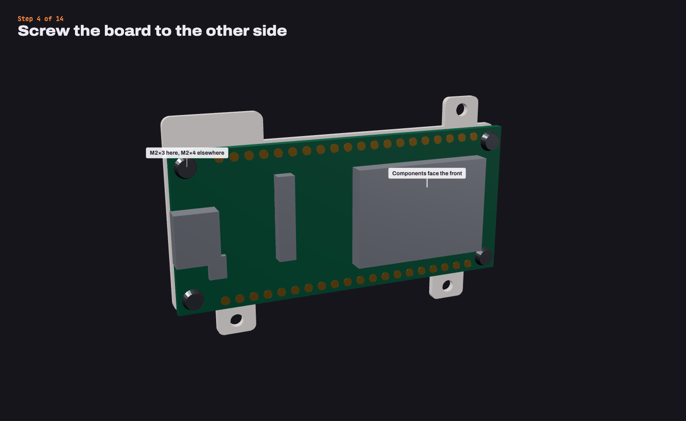

## 5. Tape on the charge module

Beside the screen with thin tape, its USB-C socket flush with the sled's right-hand edge.

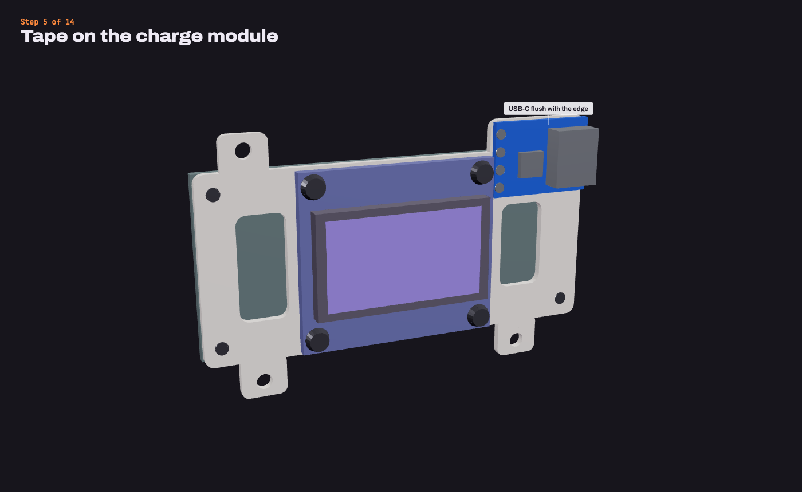

## 6. Wire the screen, then test

8 wires through the slot and under the board (board shown see-through). Bench test before going further.

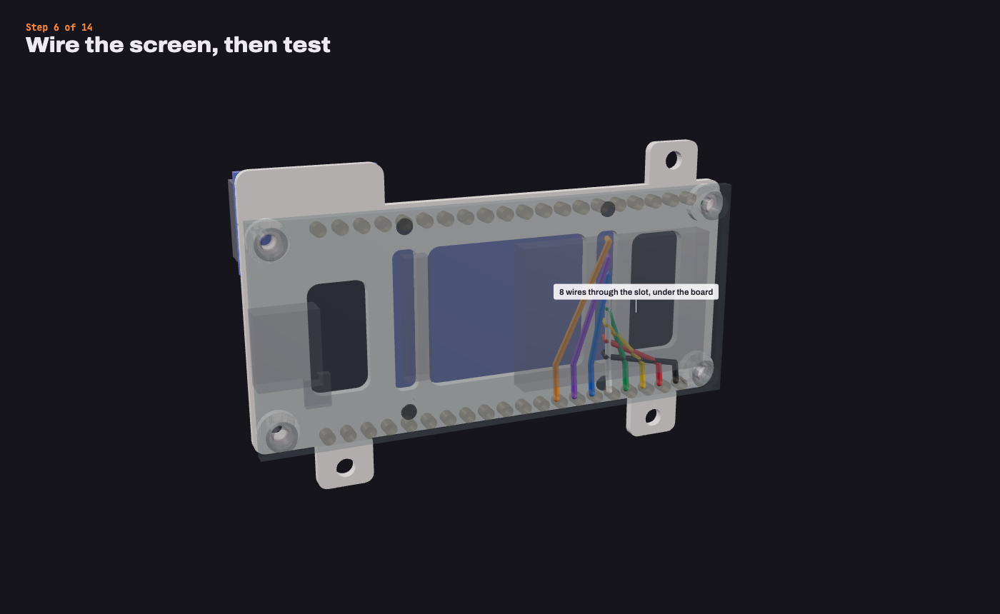

## 7. Fit the controls

Buttons glued in the shelf pockets, plungers toward the back; shutter on its ledge; slide switch dropped in from the front and slid up.

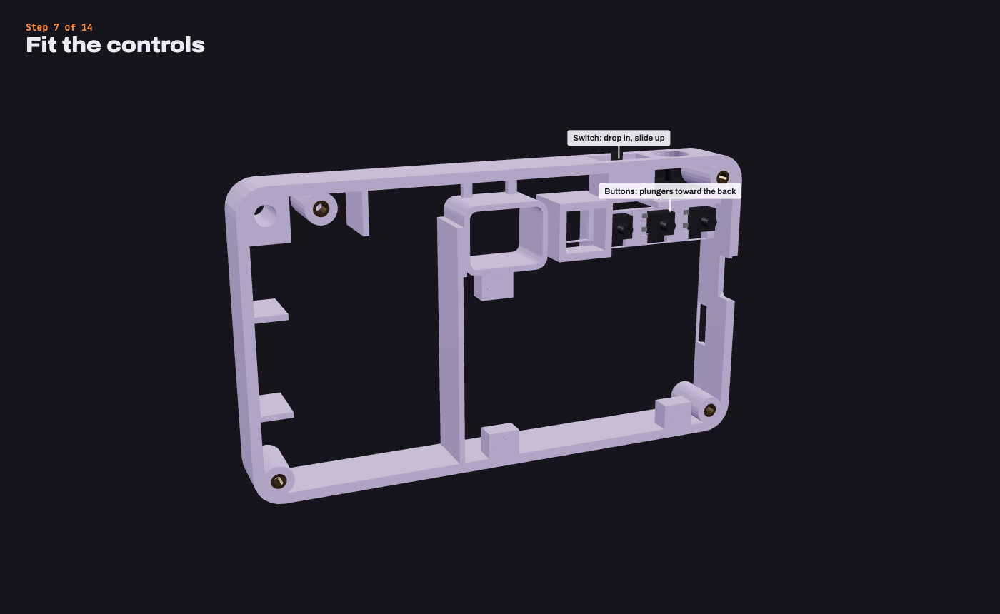

## 8. Seat the camera

Camera into its cradle from the front, ribbon out of the slot at the bottom.

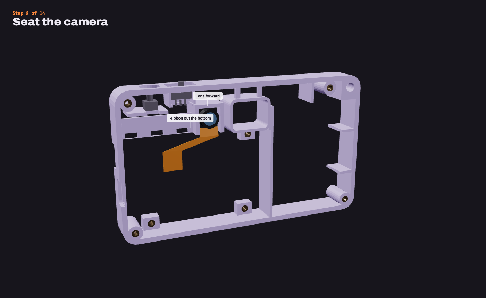

## 9. Drop in the sled

Lowered in from the front, three tabs screwed down (M2×4); then plug in the camera ribbon.

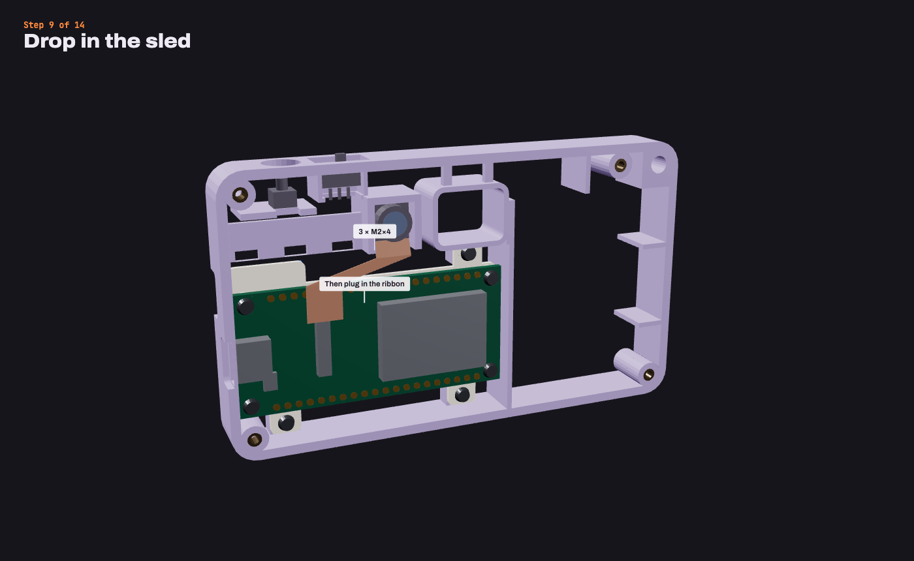

## 10. Battery and its leads

Foam on both faces; leads up, along the top lane under the bridges, down beside the lens, across to B+ and B−.

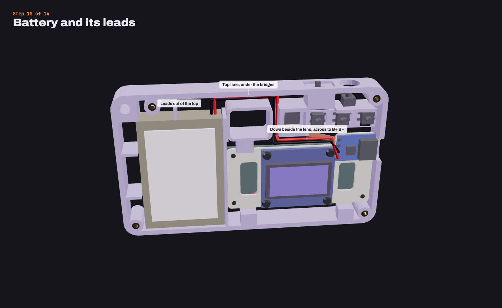

## 11. Wire the controls and power

Buttons to 2, 14, 45, 48 with a shared GND; OUT+ through the switch to 5V; 2 × 100k battery divider to GPIO 1.

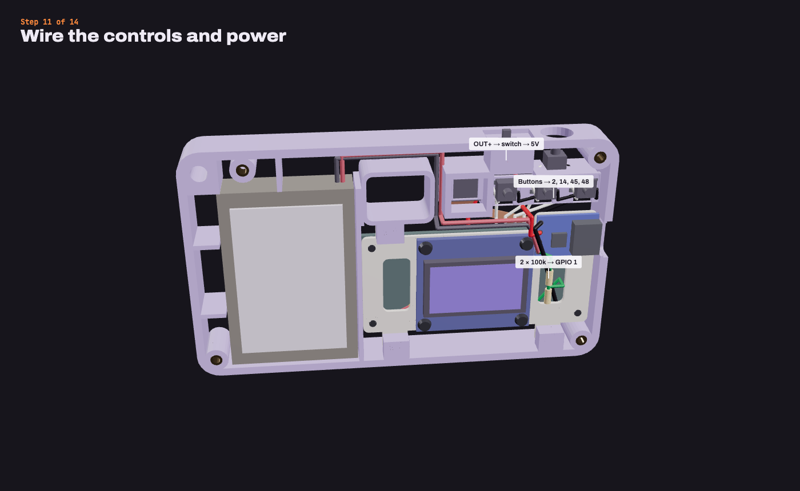

## 12. Close the back

Shutter cap and button caps in, back plate on with 4 × M2×4, viewfinder trim.

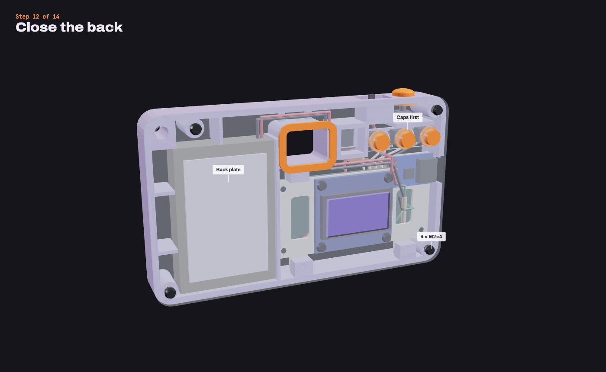

## 13. Close the front

Front plate on with 4 × M2×4 (it clamps the camera), lens ring and front trim.

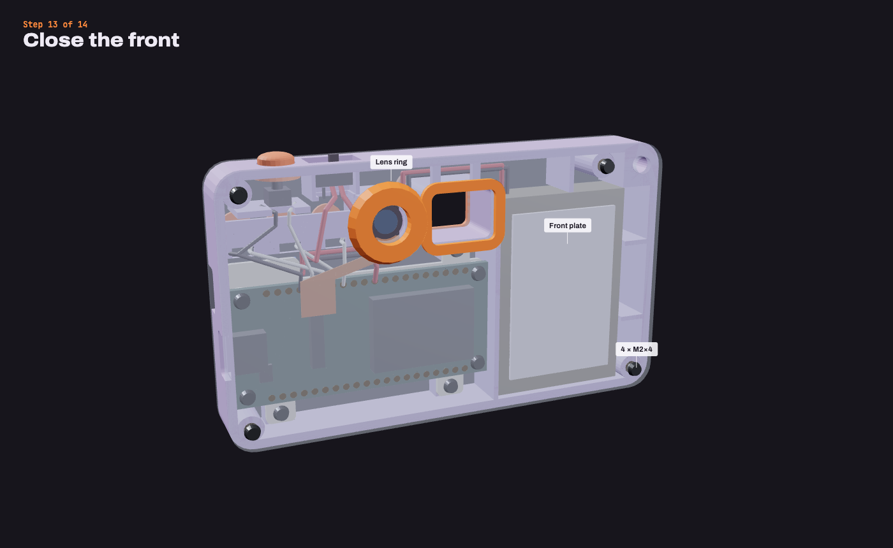

## 14. Done

110 × 64 × 15.1 mm. Charging USB-C upper right, the board's own USB-C below it.

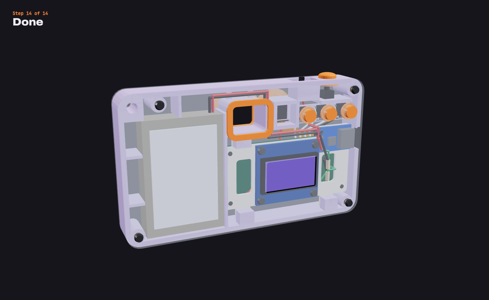
