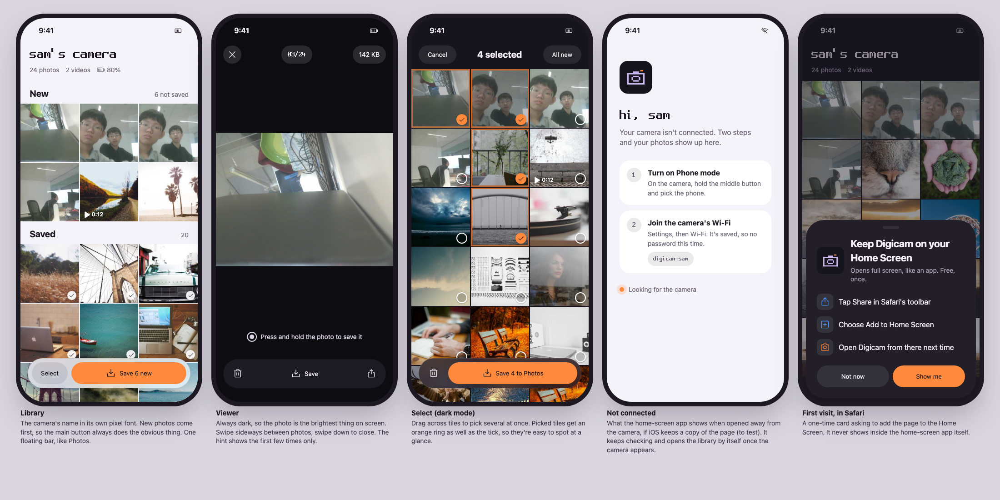

# Phone page v2: design plan and home-screen app

Status: **plan, 21 Oct 2026.** Nothing here is built yet, apart from the mockup and the assets in `design/phone-v2/`. The page that's live on the camera is still `firmware/web/phone.html` (v1, see `08-phone-app-plan.md`).

Clickable phone prototype: https://claude.ai/artifact/CNQHG8BDDdjVAAbGSsZDHT (source `design/phone-v2/proto/src.html`, built by `proto/build.py`).

Mockup: `design/phone-v2/mockup.html`, served by the `digicam-design` preview (port 8768). It uses the four photos on the card plus placeholder photos, so the grid looks full.

## Design read

A small companion photo app for a handmade gift camera, used by one friend on an iPhone. The visual language comes from the camera's own screen. It follows iOS app conventions (system font, floating toolbar, sheets, safe areas), and its signature is the camera's pixel font.

- **Shape:** it's an app screen, not a landing page, so it follows Photos-app patterns rather than marketing layouts.
- **Dials:** variance 4 (a photo grid wants order), motion 5 (every animation has a job), density 4.

## Brand, carried over from the camera

| Token | Light | Dark | Where it comes from |
| --- | --- | --- | --- |
| Background | `#f5f3fa` (lilac-tinted off-white) | `#16141c` (the camera's panel colour) | `C_PANEL`, `C_LILAC` in `gfx.h` |
| Surface | `#ffffff` | `#221f29` | |
| Ink / muted | `#1c1922` / `#6c6676` | `#f2eff7` / `#a39cae` | |
| **Accent (the only one)** | `#ff8a3d` with dark text `#1c1922` | same | `C_ORANGE`, the camera's shutter/REC colour |
| Danger | `#d93a3a` | `#ff6b6b` | delete confirm only |

**Accent:**
- Orange is the only accent. It marks the one thing to do on each screen (Save) and picked tiles.
- Orange buttons carry dark text, not white: white on this orange fails contrast (about 2.3:1), while dark text passes easily (about 7:1).
- "Saved" ticks are white and grey, not green, so there's still only one accent colour.

**Typography:**
- The UI uses the iPhone's own font (SF Pro), which costs nothing to load and makes it feel native.
- **Spleen**, the camera's pixel font, is used only for the identity moments: the camera's name, "hi, sam", the photo counter and the Wi-Fi name.
- `firmware/web/spleen_webfont.py` builds it from `font_spleen.c` as a 2.9 KB WOFF. It stays sharp at 16, 32 and 48 px.

**Shape rule, applied everywhere:**
- Photo tiles are square-cornered with 2 px gaps (like Photos).
- Every button and chip is a full pill.
- Cards and sheets have rounded corners: 22 px for cards, 40 px for sheets, following the phone's corners.

**Icons:**
- Phosphor (MIT licence), regular weight, a 15-icon sprite of 5.3 KB in `design/phone-v2/sprite.svg`.
- They're inlined because there's no internet while the phone is on the camera's Wi-Fi.

**App icon:**
- The first pixel-art icon was dropped (21 Oct): it looked too rough for a gift.
- Three vector options, drawn in the prototype's code (open Demo, then App icon options):
  - **Lens:** the lens, lilac on charcoal, with an orange shutter dot.
  - **Body:** a front view of the camera on lilac.
  - **Orange:** the lens on the camera's orange.
- Choice pending. The chosen one gets exported to `icon-180.png` and `icon-512.png` for the firmware.
- **Per-camera colours are possible:** each friend's camera could have its own icon colours, set in `personal.h`.

## Screens

1. **Library**
   - Header: the camera's name in the pixel font, then counts and battery.
   - Two sections, **New** (not yet saved to this phone) and **Saved**, each with a tick.
   - The camera has no clock, so there are no dates to group by. New vs saved is the grouping that matters anyway.
   - A floating glass toolbar holds **Select** and **Save N new**.
2. **Viewer**
   - Always dark.
   - Swipe sideways between photos (a scroll-snap strip, so the next photo follows your finger); swipe down to close.
   - Top: close, the counter in the pixel font, and the file size.
   - Bottom: delete and **Save**. There's no share button: the iPhone only allows the web share sheet on HTTPS pages.
   - The press-and-hold hint shows the first three times only.
   - Videos play in place, as now.
3. **Select**
   - Tap to pick, or drag across tiles to pick a run.
   - Picked tiles get a ring as well as the tick.
   - **All new** picks everything not yet saved.
   - Toolbar: delete and **Save N to Photos**.
4. **Not connected**
   - Shown when the app is open but the camera isn't reachable.
   - "hi, sam" in the pixel font, then two numbered steps: turn on Phone mode, and join the Wi-Fi (its name shown in the pixel font).
   - Underneath, "Looking for the camera" with a slow pulse, since it really is retrying every 2 s.
   - It switches to the library by itself once the camera answers.
5. **First visit in Safari**
   - A one-time sheet: Share, then Add to Home Screen.
   - It never appears inside the home-screen app (`navigator.standalone`).
6. **Also needed (not in the mockup):**
   - Loading skeleton: grey tiles in the grid's shape, with no spinner.
   - Empty card: "Press the shutter on the camera, then come back".
   - Delete confirm sheet.
   - Shortcut setup sheet, restyled as the same step cards as screen 4.
   - A toast after saving.

## Motion (each has a reason)

| Motion | Why |
| --- | --- |
| Tile grows into the viewer, and shrinks back on close | Shows where the photo came from and where it went back to |
| Sheets slide up | They're temporary, on top of the page |
| Tick pops when a photo is marked saved | Confirms the save happened |
| Picked tile scales to 0.96 | Feels like a physical press |
| Pulse on "Looking for the camera" | It's live, and it's working |

- **Implementation:** CSS transitions on `transform` and `opacity` only, with no library.
- **Reduced motion:** under `prefers-reduced-motion`, everything becomes an instant change.

## Home-screen app (no Apple fee)

**Yes, it works.**
- Your friend opens the page in Safari on the camera's Wi-Fi, taps Share, then **Add to Home Screen**.
- From iOS 26 every site added this way opens as a web app by default: full screen, its own icon and name, its own entry in the app switcher.
- The page adds the manifest, icon, theme colour and status-bar settings so it looks right.

**Your concern is right.**
- The app only works while the phone is on the camera's Wi-Fi.
- The page comes from the camera, over plain HTTP, so there's no service worker to keep a copy.

### What happens when it's opened away from the camera

- **Default:** iOS shows a "can't open the page" error inside the app.
- **Experiment to try:**
  - The camera serves the page with a long cache lifetime and a version number.
  - The iPhone may then open it straight from its cache with no network. If so, the page's own "Not connected" screen (screen 4) appears and keeps looking for the camera.
  - The page then refreshes itself when the camera reports a newer firmware version.
  - Whether a home-screen app does this on iOS isn't documented, so it has to be tried on the phone. If it doesn't work, nothing is lost: we're back to the error page.

### Other trade-offs

- **Joining Wi-Fi:**
  - Away from other Wi-Fi, iOS rejoins the camera's network by itself.
  - **At home** it stays on the home network, so she has to pick `digicam-xxxx` once in Wi-Fi settings or Control Center (long-press the Wi-Fi tile).
  - A web page can't switch Wi-Fi for her. Only a paid native app could.
- **Internet:** while on the camera's Wi-Fi, iOS says "No Internet Connection". Other apps fall back to mobile data.
- **"Saved" ticks:** the home-screen app keeps its own memory, separate from Safari's, so ticks start fresh the first time. That's fine, because she'll use the app from then on.
- **Shortcut (save many):**
  - Opening it leaves the app.
  - iOS shows a "◀ Digicam" back link at the top left. The callback URL would land in Safari instead, so we drop the callbacks and the app re-checks when it's opened again.
- **Press-and-hold Save:** expected to work inside the app, but **test on the phone**.
- **Both cameras use 192.168.4.1:** one home-screen app works with either camera. It reads the name from whichever camera it's talking to.
- **Later option:** the camera could also join the home Wi-Fi when it's in range, so no network switching is needed at home. It needs a way to enter the home Wi-Fi password, so it's not planned for 31 Oct.

## Firmware changes this needs

| Change | Size |
| --- | --- |
| `GET /manifest.webmanifest`, `/icon-180.png`, `/icon-512.png` | about 3 KB |
| `/api/list` adds `"fw"` (firmware version) so the page can refresh itself | tiny |
| Serve the page gzipped (`Content-Encoding: gzip`), built at compile time | page about 45 KB, sent as about 15 KB |
| Cache header on `/` for the offline experiment | one line |
| (optional) per-camera icon colours from `personal.h` | tiny |

**Flash:** about 370 KB of the 1.5 MB app slot is free, so all of this fits easily.

**Load on the ESP32:** unchanged. It sends a small file once per visit, and everything else runs on the phone.

## Order of work

1. Test v1 on the iPhone first:
   - joining with the QR code;
   - press-and-hold Save;
   - the Shortcut;
   - Add to Home Screen;
   - the transfer speeds from the new log line.
2. Build the v2 page from the mockup, on the laptop via `host/server.py` `/phone/`, in both themes and at phone size.
3. Firmware: manifest, icons, gzip, `fw` version, cache header. Flash.
4. On the iPhone: add to Home Screen, open it away from the camera (the offline experiment), and check the save paths inside the app.
